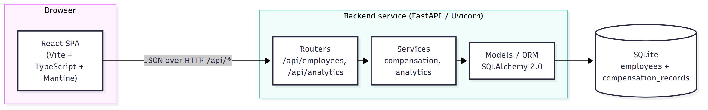

# Salary Management

Web-based salary management software for an organization with ~10,000 employees across
multiple countries. It replaces spreadsheet-based HR workflows and lets an HR Manager
manage employee salary data and answer questions about how the org pays people.

Built as a take-home assessment. See [`docs/REQUIREMENTS.md`](docs/REQUIREMENTS.md) for
scope and [`docs/ARCHITECTURE.md`](docs/ARCHITECTURE.md) for the design.



_(Full set of diagrams — data model, deployment topology, request flow — in
[`docs/ARCHITECTURE.md`](docs/ARCHITECTURE.md).)_

## Features

- **Employee directory** — server-side search (name/code/email), filtering (country,
  department, status), sorting, and pagination that stays fast at 10k rows.
- **Employee profile** — identity, manager, and an **effective-dated salary history** with a
  record-a-salary-change flow (history is append-only, never overwritten).
- **Create / edit employees** — with a required starting compensation record.
- **Pay analytics dashboard** — total payroll, average & median salary, headcount and pay
  **by country and department**, and a salary distribution — all normalized to USD.
- **CSV export** of the filtered directory.
- **Deterministic seed** of 10,000 employees with realistic multi-country salary history.

## Tech stack

| Layer    | Choice                                     |
| -------- | ------------------------------------------ |
| Backend  | Python · FastAPI · SQLAlchemy 2.0          |
| Database | SQLite (relational)                        |
| Frontend | React · Vite · TypeScript · Mantine · Recharts |
| Tests    | pytest (backend) · Vitest + RTL (frontend) |

## Project layout

```
backend/
  app/
    models.py          Employee + effective-dated CompensationRecord
    schemas.py         Pydantic request/response contracts
    services/          business logic (compensation, analytics, shared salary SQL)
    routers/           HTTP layer (employees, analytics, reference)
    reference.py       countries, FX rates, salary bands
    seed.py            deterministic 10k seed
  tests/               pytest unit + API tests
frontend/
  src/
    api/               typed API client + types + reference context
    components/         shared UI (layout, status badge, modals)
    pages/             directory, detail, new employee, dashboard
    lib/               formatting + option helpers
    test/              Vitest setup + render helper
docs/                   requirements, architecture, decisions, prompts, demo
```

## Quick start

> Prerequisites: Python 3.10+, Node 18+.

### 1. Backend (API on :8000)

```bash
cd backend
python -m venv .venv
```

Activate the venv — Windows: `.venv\Scripts\activate` · macOS/Linux: `source .venv/bin/activate` — then:

```bash
pip install -e ".[dev]"
python -m app.seed
uvicorn app.main:app --reload
```

The API is at http://localhost:8000, with interactive docs at http://localhost:8000/docs.

### 2. Frontend (app on :5173)

```bash
cd frontend
npm install
npm run dev
```

Open http://localhost:5173. The dev server proxies `/api` to the backend, so both must be
running.

## Tests

Backend:

```bash
cd backend
pytest
```

Frontend:

```bash
cd frontend
npm run test
```

## Seeding

The seed is deterministic — the same seed produces identical data every run.

```bash
cd backend
python -m app.seed              # 10,000 employees (default)
python -m app.seed --count 500  # smaller dataset
python -m app.seed --seed 7     # different deterministic dataset
```

## Deployment

The app ships as a **single service**: FastAPI serves the built React assets (with an SPA
fallback) and the JSON API from one process, and auto-seeds the database on first boot if it
is empty. A multi-stage `Dockerfile` builds the frontend and bakes a seeded database into the
image.

### Run the container locally

```bash
docker build -t salary-management .
```

```bash
docker run -p 8000:8000 salary-management
```

Then open http://localhost:8000 — the full app (UI + API) runs from the one container.

### Deploy to Render (free)

1. Push this repository to GitHub.
2. In Render: **New → Blueprint**, connect the repo. Render reads [`render.yaml`](render.yaml)
   and builds the `Dockerfile` as a free web service.
3. When the build finishes, open the provided URL.

> The free tier spins the service down when idle, so the **first request after a lull takes
> ~30–60s** (cold start) before the app responds. The `Dockerfile` runs identically on any
> container host (Fly.io, Railway, Cloud Run, …) if you prefer no cold start.

### Configuration (environment variables)

| Variable | Default | Purpose |
| --- | --- | --- |
| `SALARY_DATABASE_URL` | local SQLite file | Database connection (swap for Postgres by URL) |
| `SALARY_STATIC_DIR` | `backend/static` | Directory of the built frontend to serve |
| `SALARY_SEED_ON_STARTUP` | `10000` | Auto-seed this many employees if the DB is empty (0 disables) |
| `PORT` | `8000` | Port to bind (set automatically by most PaaS) |

## Documentation & artifacts

| Document | Contents |
| --- | --- |
| [`docs/REQUIREMENTS.md`](docs/REQUIREMENTS.md) | One-page scope, features, deliberate non-goals |
| [`docs/ARCHITECTURE.md`](docs/ARCHITECTURE.md) | System, data-model, deployment & flow diagrams; tech rationale; performance |
| [`docs/DECISIONS.md`](docs/DECISIONS.md) | Key trade-offs and the reasoning behind them |
| [`docs/PROMPTS.md`](docs/PROMPTS.md) | How AI tools were used, with representative prompts |
| [`docs/DEMO.md`](docs/DEMO.md) | Click-through script for the demo video |
