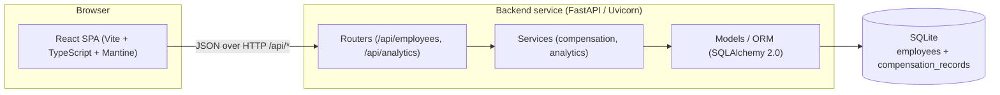
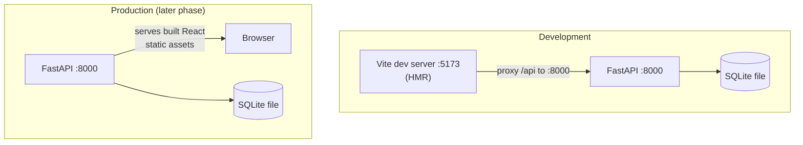
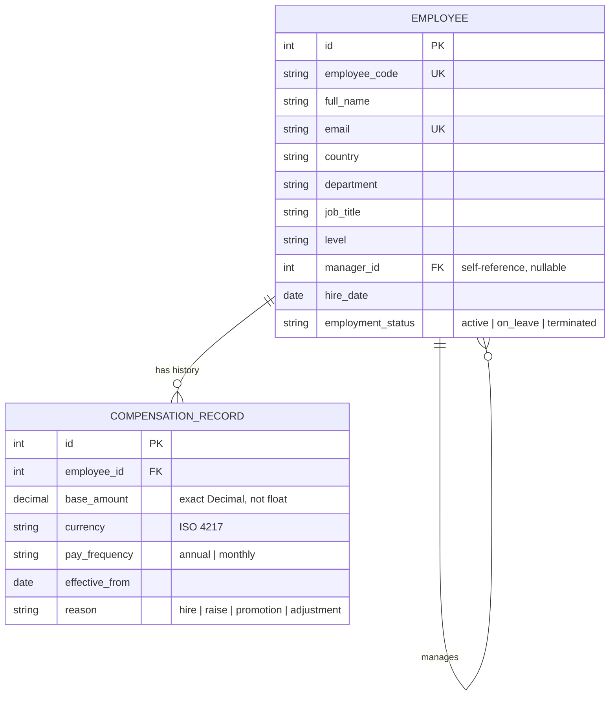
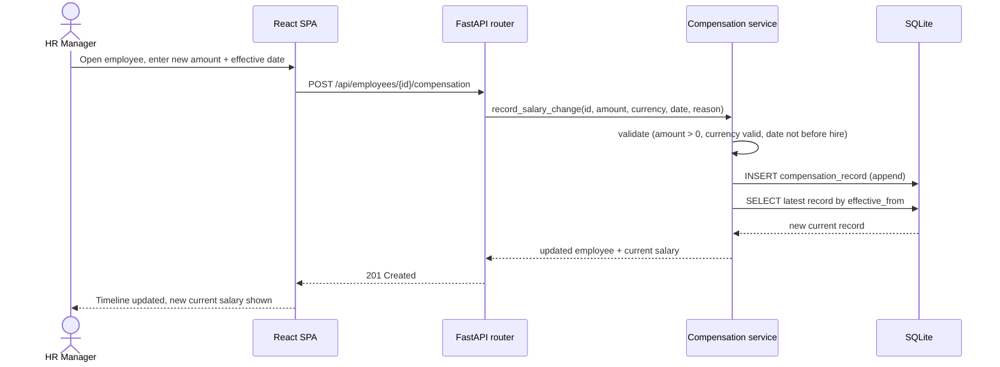

# Architecture — Salary Management

This document describes the system design, the technology choices and why they were made,
and how the main flows work. Diagrams are written in Mermaid so they render inline on GitHub
and stay versioned alongside the code.

## 1. System overview

A conventional two-tier web application: a React single-page app talks to a FastAPI backend
over a small JSON REST API; the backend owns all business logic and persists to SQLite.

The backend is deliberately **layered** so responsibilities stay separated and testable:

| Layer | Responsibility | Depends on |
| --- | --- | --- |
| **Routers** | HTTP concerns: request/response shape, status codes, validation wiring | Services, Schemas |
| **Services** | Business logic: current-salary resolution, salary-change rules, aggregation & currency normalization | Models |
| **Models** | Persistence: tables, relationships, indexes | Database |
| **Schemas** | Pydantic request/response contracts (decoupled from ORM models) | — |

Business logic lives in **services**, not routers, so it can be unit-tested without HTTP and
reused across endpoints.

## 2. Deployment topology (dev vs. prod)

Two servers in development; one deployable service in production. Deciding this up front means
the frontend's API base path is correct from day one.

- **Dev:** Vite serves the SPA with hot reload and proxies `/api` to FastAPI, so the browser
  sees a single origin and there are no CORS surprises.
- **Prod:** `npm run build` emits static assets that FastAPI serves via `StaticFiles`. The
  whole app ships as **one process** — simplest possible free-tier deploy, no separate frontend
  host, no cross-origin configuration.

## 3. Data model

Compensation is modeled as an **effective-dated history**, not a single mutable salary column.
This is the central design decision — it preserves an audit trail and lets the app answer
questions about pay *over time*.

- **Current salary** = the compensation record with the latest `effective_from` for an
  employee. There is no denormalized "current salary" column to drift out of sync.
- A salary change is an **append** (new record), never an update — history is immutable.
- `manager_id` is a nullable self-reference (org hierarchy without a separate table).

### Indexing for 10k employees

| Index | Supports |
| --- | --- |
| `employee_code`, `email` (unique) | lookups and integrity |
| `country`, `department`, `employment_status` | directory filters and `GROUP BY` analytics |
| `(employee_id, effective_from)` | fast current-salary / history resolution |

## 4. Key flow — recording a salary raise

Shows how "current salary" stays correct without a mutable field.

## 5. Analytics approach

Aggregations run as SQL `GROUP BY` queries in the database, **not** as Python loops over
10k rows. Averages, counts, and bucketed distributions are computed server-side; medians are
computed with a windowed/ordered query (or a single ordered pull per group where SQLite
lacks a native median). Every monetary figure is normalized to USD via the seeded FX table so
cross-country totals are comparable. This keeps the dashboard fast and the math correct and
testable in isolation.

## 6. Technology choices & rationale

| Choice | Why | Alternative considered |
| --- | --- | --- |
| **FastAPI** | Typed, async-capable, auto-generates OpenAPI/Swagger docs (free interactive API explorer for reviewers), minimal boilerplate | Django (heavier for an API-only service); Flask (less typing/validation out of the box) |
| **SQLAlchemy 2.0** | Mature typed ORM; same code works against SQLite now and Postgres later | Raw SQL (more boilerplate, less safety) |
| **SQLite** | Zero-setup relational DB, perfect for a self-contained deliverable; migrates to Postgres with a URL change | Postgres (needs a running service for a take-home) |
| **Pydantic v2** | Request/response validation + serialization, decoupled from ORM models | Hand-rolled serializers |
| **React + Vite + TS** | Fast dev loop, type safety across the UI, tiny modern build | CRA (deprecated), Next.js (SSR unneeded for an internal tool) |
| **Mantine** | Batteries-included components (data table, forms, modals, notifications) so effort goes into product logic, not UI primitives | MUI (heavier), hand-built components (slower) |
| **Recharts** | Simple declarative charts for the dashboard | D3 (overkill), Chart.js (less React-native) |
| **Decimal for money** | Avoids floating-point rounding errors in financial data | float (incorrect for currency) |

## 7. Performance considerations

- **Server-side pagination + filtering** — the directory endpoint returns one page at a time;
  the client never holds 10k rows.
- **SQL aggregation** — analytics computed in the database, scaling far better than
  materializing rows into Python.
- **Targeted indexes** — on every filter/group column and the history-resolution key.
- **Deterministic seed** — fixed RNG seed so data (and therefore tests and demos) are
  reproducible run to run.
